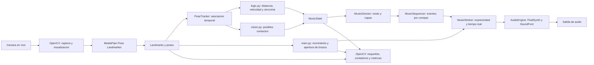

# Resonantia

Instalación artística e interactiva que traduce el movimiento y la conexión humana en música generativa.

## Integrantes
* Salomon David Ramirez
* Juan Pablo Rueda Sanchez
* Juan Esteban Galindo Mina

## Descripción del proyecto

### Problemática y justificación

Las interfaces digitales suelen separar a las personas o reducir su interacción a acciones individuales. Resonantia explora una alternativa artística: usar visión por computadora y música generativa para hacer perceptibles el movimiento, la proximidad y la interacción compartida. La música funciona como respuesta inmediata del sistema y como invitación a explorar el espacio en conjunto.

### Objetivos

- **General:** desarrollar una instalación interactiva que traduzca movimientos e interacciones observados por cámara en cambios musicales en tiempo real.
- **Específicos:** detectar poses de varias personas; estimar movimiento, sincronía y posibles contactos; convertir esas medidas en estados y eventos musicales; y visualizar en pantalla la información principal del sistema.

### Solución propuesta

La aplicación procesa el video de una cámara con MediaPipe Pose Landmarker, calcula métricas sobre coordenadas normalizadas y clasifica la escena en cuatro modos musicales. Un director y un secuenciador generan eventos MIDI que FluidSynth reproduce mediante una salida de audio. El movimiento del torso y la apertura de los brazos también afectan la intensidad y el registro de la melodía. La imagen procesada y las métricas se muestran en una ventana de OpenCV.

---

## Arquitectura del sistema

El siguiente diagrama representa el flujo de datos y los componentes ejecutados por `main py`:



`MusicWorker` ejecuta la reproducción en un hilo independiente para que el ciclo de captura de cámara siga actualizando el estado. `AudioEngine` llama a la biblioteca nativa FluidSynth y `sounddevice` entrega el audio generado a la salida del sistema.

### Componentes del código

```
main.py                 # Integra camara, vision, worker musical, audio y GUI
src/
├── vision.py           # Pose Landmarker, seguimiento y posibles contactos
├── logic.py            # Metricas geometricas y de sincronizacion
├── music_theory.py     # Escala, acordes y progresion armonica
├── music_director.py   # Estado humano -> modo y capas musicales
├── music_sequencer.py  # Decisiones -> eventos musicales/MIDI
├── audio_engine.py     # Sintesis FluidSynth y salida con sounddevice
└── test_audio.py       # Prueba manual de una nota sostenida
tests/
└── test_logic.py       # Pruebas automatizadas de metricas y tracking
```

---

## Instalación y Configuración

### 1. Crear entorno virtual
```powershell
python -m venv ambiente
ambiente\Scripts\activate
```

### 2. Instalar dependencias de Python
```powershell
pip install -r requirements.txt
```
Las dependencias incluyen OpenCV, MediaPipe, NumPy y `sounddevice` para la salida de audio. La interfaz usa Tkinter, incluido en las instalaciones habituales de Python para Windows.

### 3. Preparar el modelo de pose

Si `assets/pose_landmarker_lite.task` no está disponible localmente, descárgalo:

```powershell
New-Item -ItemType Directory -Force assets
Invoke-WebRequest `
  -Uri "https://storage.googleapis.com/mediapipe-models/pose_landmarker/pose_landmarker_lite/float16/1/pose_landmarker_lite.task" `
  -OutFile "assets/pose_landmarker_lite.task"
```
El modelo se ignora en Git. Se requiere Windows para la configuración actual del motor de audio, que carga las DLL incluidas en `fluidsynth-v2.6.2-win10-x64-cpp11`.

### 4. Preparar el SoundFont

Si quieres reproducir música, coloca `The_Absolute_Sega_FM_Soundfont_V2.sf2` dentro de `Soundfonts/` en la raíz del proyecto. La opción de audio está desactivada inicialmente; la interfaz también funciona en modo de análisis visual sin SoundFont. El archivo SoundFont está ignorado en Git: obténlo por separado y verifica sus condiciones de licencia antes de distribuirlo.

---

## Ejecución

### Aplicación gráfica (cámara, análisis y música)

Desde la raíz del repositorio:

```powershell
python main.py
```

La ventana permite:

1. Elegir el índice de cámara **0–5** en la lista.
2. Dejar **Reproducir música** desmarcado para usar solo la cámara y el análisis, o marcarlo para activar FluidSynth. Para el audio se requiere el SoundFont local, las DLL de FluidSynth incluidas en el proyecto y una salida de audio.
3. Pulsar **Iniciar** y situarse frente a la cámara, con buena iluminación y manos visibles. El estado inferior informa si la cámara está activa o si se produjo un error.
4. Consultar el video y las métricas en vivo. En **Personas**, seleccionar un ID para inspeccionar sus puntos corporales; las pestañas **Distancias**, **Contactos** y **Música** presentan los datos de las parejas, interacciones estimadas y eventos musicales.
5. Pulsar **Detener** para liberar cámara/audio o **Salir** para cerrar la aplicación.

La interfaz muestra cantidad de personas y contactos, sincronía grupal, movimiento, apertura de brazos, FPS, modo y acorde actuales; por persona, ID, centro normalizado, desplazamiento, velocidad X/Y, rapidez y dirección; por pareja, distancia y sincronía; y para cada contacto estimado, tipo, IDs y puntos aproximados. La pestaña de puntos corporales incluye los 33 landmarks de cada persona detectada con coordenadas X/Y/Z, visibilidad y presencia. La pestaña musical lista capas, densidad, intensidad y eventos MIDI por pulso.

Los valores X/Y y las distancias son relativos a la imagen, no unidades físicas. Un contacto detectado es solo una estimación 2D.

### Modo de análisis de visión independiente

```powershell
python src/vision.py
```
- Presiona **ESC** para salir
- Cámara por defecto: índice `0` (`CAMERA_INDEX` en `vision.py`)
- Muestra: esqueleto, centro de cuerpo, ID temporal, métricas de movimiento, contactos, distancias entre pares, sincronía grupal

### Pruebas y ejemplos de módulos musicales

Ejecuta las pruebas automatizadas:

```powershell
python -m unittest discover -s tests -v
```

Los siguientes módulos también incluyen demostraciones ejecutables que imprimen resultados en consola; no son pruebas automatizadas:

```powershell
python src/music_theory.py
python src/music_director.py
python src/music_sequencer.py
```

---

## Lógica Musical: 4 Modos

| Modo | Condición | Capas activas | Densidad | Intensidad |
|------|-----------|---------------|----------|------------|
| **silence** | 0 personas | *ninguna* (silencio) | 0.0 | 0.0 |
| **solo** | 1 persona | melody | 0.3 | 0.3 |
| **exploration** | 2+ personas, sin contacto | melody, drums (+bass si synchrony≥0.5) | 0.5 | 0.45 |
| **connection** | 2+ personas, **contacto detectado** | bass, drums, harmony, melody | 0.9 | 0.8 |

Estas capas describen las decisiones y eventos del secuenciador. En la reproducción integrada actual, `ResonantiaAudio` omite los eventos `kick` y `hihat`; por tanto, la percusión se genera en la secuencia pero todavía no se escucha.

**Progresión armónica (4 compases → loop):**
```
Am9  →  Fmaj7  →  Cmaj7  →  G6
(La)     (Fa)      (Do)      (Sol)
```

**Notas por capa (registros MIDI):**
- **Bass**: fundamental del acorde (MIDI 28–43)
- **Chords**: notas del acorde (MIDI 60–76), acordes sostenidos 4 tiempos
- **Melody**: notas del acorde en patrón (0,2,3,2), registro MIDI 72–88
- **Drums**: Kick (36) en 1 y 3; Hi-hat (42) en cada tiempo

---

## Métricas de Interacción (vision.py)

| Métrica | Descripción | Unidades |
|---------|-------------|----------|
| **Desplazamiento** | Distancia centro actual vs anterior | Normalizado (0–1) |
| **Velocidad** | Módulo del vector velocidad | Normalizado/segundo |
| **Dirección** | Ángulo del vector velocidad | Grados (0°=→, 90°=↓) |
| **Distancia entre pares** | Centro persona A ↔ centro persona B | Normalizado (0–1) |
| **Sincronía instantánea** | Similitud dirección + velocidad entre pares móviles | 0–1 |
| **Sincronía grupal** | Promedio de sincronía entre todas las parejas móviles | 0–1 |

> **Nota:** Las coordenadas son normalizadas (0–1 ancho/alto de imagen). No hay calibración métrica real.

---

## Detección de Contactos

| Tipo | Condición | Umbral |
|------|-----------|--------|
| **Posible contacto de manos** | Distancia muñeca–muñeca < threshold | `max(0.025, min(0.06, ancho_hombros * 0.18))` |
| **Posible contacto de brazos** | Distancia muñeca–segmento_brazo < threshold | Mismo umbral adaptativo |

> **Limitación:** Basado en distancia 2D. No confirma agarre físico. Sensible a perspectiva, oclusión y posición de cámara.

---

## Tracking de Personas

- **Algoritmo:** Asociación por cercanía de centros (greedy matching)
- **Máx. personas simultáneas:** 4 (`MAX_PEOPLE`)
- **Distancia máx. asociación:** 0.15 normalizado
- **Frames máx. perdidos:** 10 (`max_missed_frames`)
- **IDs:** Temporales, se renuevan si la persona sale y reaparece
- **Limitación:** Puede confundir IDs si personas se cruzan, ocultan o mueven rápido

---

## Metodología y técnicas implementadas

1. **Captura:** OpenCV obtiene fotogramas de la cámara; se convierten a RGB y se envían a MediaPipe en modo video.
2. **Estimación de pose:** Pose Landmarker Lite detecta hasta cuatro poses y produce landmarks normalizados. Se descartan puntos con visibilidad inferior a `0.5`.
3. **Seguimiento y análisis:** `PoseTracker` asocia centros de poses entre fotogramas mediante emparejamiento greedy por distancia. `logic.py` calcula desplazamientos, velocidades, dirección, distancias y sincronía por parejas/grupal. `vision.py` estima posibles contactos de manos o brazos con umbrales relativos al ancho de hombros.
4. **Mapeo musical:** `MusicDirector` elige `silence`, `solo`, `exploration` o `connection`; `MusicSequencer` traduce esa decisión a notas, duraciones y velocidades en una progresión de cuatro acordes.
5. **Expresión, reproducción y visualización:** `MusicWorker` suaviza movimiento y apertura de brazos, modifica la melodía y coordina compases. FluidSynth sintetiza el sonido; OpenCV dibuja los resultados sobre el video.

El sistema usa MediaPipe Pose Landmarker Lite como modelo preentrenado de estimación de pose. No se entrena un modelo propio ni se estima identidad de las personas. La “sincronía” es una medida geométrica del parecido entre velocidad y dirección de movimiento, no una evaluación psicológica o social.

## Datos utilizados

- **Entrada principal:** fotogramas en vivo de una cámara local; no se incluye un conjunto de videos etiquetados ni se guardan grabaciones.
- **Datos derivados:** landmarks, centros y métricas normalizadas procesados en memoria durante la sesión.
- **Modelo:** [Pose Landmarker Lite](https://storage.googleapis.com/mediapipe-models/pose_landmarker/pose_landmarker_lite/float16/1/pose_landmarker_lite.task), descargable desde Google. El archivo local está excluido de Git.
- **Audio:** SoundFont `The_Absolute_Sega_FM_Soundfont_V2.sf2`, que debe obtenerse y colocarse localmente en `Soundfonts/`.

No se publican datos de participantes ni resultados de una colección de videos; la validación disponible corresponde a pruebas de funciones y a la ejecución interactiva con cámara.

## Interfaz gráfica de usuario

La GUI está implementada en `main.py` con Tkinter y muestra el video procesado junto con paneles de estado y tablas. Incluye selección de cámara, opción de habilitar audio, controles **Iniciar**, **Detener** y **Salir**, mensajes de error, una tabla de métricas por persona y pestañas para distancias, posibles contactos, puntos corporales y eventos musicales. La selección de un ID en **Personas** actualiza la tabla con sus 33 landmarks.

No se incluyen capturas de pantalla versionadas. La propia ventana constituye la evidencia visual: al ejecutar la aplicación con una cámara y el modelo local disponibles, aparecen el esqueleto y las métricas; para oír música hay que habilitar la opción y preparar el SoundFont.

## Resultados y evaluación

Las pruebas automatizadas de `tests/test_logic.py` comprueban distancias normalizadas, cálculo de velocidad y dirección, validación de tiempo positivo, sincronía individual y grupal, orden de distancias por ID y actualización de movimiento del tracker.

**Resultado verificado:** `python -m unittest discover -s tests -v` ejecutado con el entorno virtual del proyecto terminó correctamente: **8 pruebas aprobadas, 0 fallidas**. Estas pruebas son unitarias; no miden precisión de pose, latencia, tasa de falsos contactos ni calidad musical.

Como ejemplo de funcionamiento definido por las reglas del director, cero personas produce el modo `silence`; una persona, `solo`; dos o más sin contacto, `exploration`; y dos o más con contacto estimado, `connection`. La aplicación completa produce audio con las capas admitidas por el motor actual, pero no se ha documentado una evaluación cuantitativa con participantes o grabaciones.

## Conclusiones, limitaciones y mejoras

El proyecto integra visión en tiempo real, métricas de movimiento, reglas musicales, secuenciación y síntesis de audio. Las pruebas existentes dan cobertura a cálculos y seguimiento básicos, pero no validan por sí solas el desempeño de la instalación completa.

Limitaciones actuales:

- El seguimiento por distancia de centros puede intercambiar IDs durante cruces, oclusiones o movimientos rápidos.
- El contacto se estima en 2D y no confirma contacto físico; perspectiva, oclusión y visibilidad afectan el resultado.
- Las distancias y velocidades están normalizadas, sin calibración en unidades físicas.
- La interfaz permite elegir índices de cámara `0–5`, pero no detecta automáticamente qué índices están disponibles ni permite cambiar los umbrales de visión.
- La salida de audio actual es específica de Windows y requiere dependencias y archivos locales externos al repositorio.
- El secuenciador incluye percusión, pero la reproducción integrada no la envía al motor de audio.
- No hay guardado de sesiones, registro de resultados, conjunto de datos ni capturas de evidencia.

Oportunidades de mejora: habilitar reproducción de percusión, medir latencia y robustez con pruebas de sistema, incorporar calibración y seguimiento más estable, añadir configuración de dispositivos/umbrales y documentar sesiones de evaluación con consentimiento.

## Estructura de directorios

```
trabajoPDI/
├── main.py
├── assets/                 # Modelo local (ignorado por Git)
├── Soundfonts/             # SoundFont local (ignorado por Git)
├── requirements.txt
├── README.md
├── src/
│   ├── vision.py
│   ├── logic.py
│   ├── music_theory.py
│   ├── music_director.py
│   ├── music_sequencer.py
│   ├── audio_engine.py
│   └── test_audio.py
└── tests/
    └── test_logic.py
```

## Licencia / Créditos

Proyecto académico – PDI (Procesamiento Digital de Imágenes).
Modelo de pose: **MediaPipe Pose Landmarker Lite** (Google, Apache 2.0).