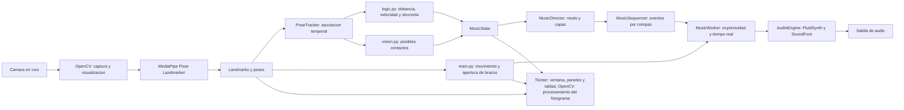

# Resonantia


Instalación artística e interactiva que traduce el movimiento y la conexión humana en música generativa.


## Integrantes

* Salomon David Ramirez

* Juan Pablo Rueda Sanchez

* Juan Esteban Galindo Mina


## Descripción del proyecto


### Problemática y justificación


Las interfaces digitales suelen separar a las personas o reducir su interacción a acciones individuales. Resonantia explora una alternativa artística: usar visión por computadora y música generativa para hacer perceptibles el movimiento, la proximidad y la interacción compartida. La música funciona como respuesta inmediata del sistema y como invitación a explorar el espacio en conjunto.


### Objetivos


- **General:** desarrollar una instalación interactiva que traduzca movimientos e interacciones observados por cámara en cambios musicales en tiempo real.

- **Específicos:** detectar poses de varias personas; estimar movimiento, sincronía y posibles contactos; convertir esas medidas en estados y eventos musicales; y visualizar en pantalla la información principal del sistema.


### Solución propuesta


La aplicación procesa el video de una cámara con MediaPipe Pose Landmarker, calcula métricas sobre coordenadas normalizadas y clasifica la escena en cuatro modos musicales. Un director y un secuenciador generan eventos MIDI que FluidSynth reproduce mediante una salida de audio. El movimiento del torso y la apertura de los brazos también afectan la intensidad y el registro de la melodía. La interfaz de control está implementada con Tkinter. OpenCV se utiliza para capturar, procesar y dibujar sobre los fotogramas de la cámara; la GUI de `main.py` presenta el video y los paneles de métricas.


---


## Arquitectura del sistema


El siguiente diagrama representa el flujo de datos y los componentes ejecutados por `main.py`:





`MusicWorker` ejecuta la reproducción en un hilo independiente para que el ciclo de captura de cámara siga actualizando el estado. `AudioEngine` llama a la biblioteca nativa FluidSynth y `sounddevice` entrega el audio generado a la salida del sistema.


### Componentes del código


```

main.py                 # Integra cámara, visión, worker musical, audio y GUI
src/
├── vision.py            # Pose Landmarker, seguimiento e interacciones
├── logic.py             # Métricas geométricas y de sincronización
├── music_theory.py      # Escala, acordes y progresión armónica
├── music_director.py   # Estado humano -> modo y capas musicales
├── music_sequencer.py  # Decisiones -> eventos musicales/MIDI
├── audio_engine.py     # Síntesis FluidSynth y salida sounddevice
├── motion_phrase.py    # Detección temporal de fases del movimiento
└── test_audio_engine.py # Prueba de audio opcional
test_logic.py            # Pruebas automatizadas de lógica y tracking

```


---


## Instalación y Configuración


### 1. Crear entorno virtual

```powershell

python -m venv ambiente

ambiente\Scripts\activate

```


### 2. Instalar dependencias de Python

```powershell

pip install -r requirements.txt

```

Las dependencias incluyen OpenCV, MediaPipe, NumPy y `sounddevice` para la salida de audio. La interfaz gráfica utiliza Tkinter, incluido en las instalaciones habituales de Python para Windows.


### 3. Preparar el modelo de pose


Si `assets/pose_landmarker_lite.task` no está disponible localmente, descárgalo:


```powershell

New-Item -ItemType Directory -Force assets

Invoke-WebRequest `

  -Uri "https\://storage.googleapis.com/mediapipe-models/pose_landmarker/pose_landmarker_lite/float16/1/pose_landmarker_lite.task" `

  -OutFile "assets/pose_landmarker_lite.task"

```

El modelo se ignora en Git. Se requiere Windows para la configuración actual del motor de audio, que carga las DLL incluidas en `fluidsynth-v2.6.2-win10-x64-cpp11`.


### 4. Preparar el SoundFont


Si quieres reproducir música, coloca `The_Absolute_Sega_FM_Soundfont_V2.sf2` dentro de `soundfonts/` en la raíz del proyecto. La opción de audio está desactivada inicialmente; la interfaz también funciona en modo de análisis visual sin SoundFont. El archivo SoundFont está ignorado en Git: obténlo por separado y verifica sus condiciones de licencia antes de distribuirlo.


---


## Ejecución


### Aplicación gráfica (cámara, análisis y música)


Desde la raíz del repositorio:


```powershell

python main.py

```


La ventana permite:


1\. Elegir el índice de cámara **0–5** en la lista.

2\. Dejar **Reproducir música** desmarcado para usar solo la cámara y el análisis, o marcarlo para activar FluidSynth. Para el audio se requiere el SoundFont local, las DLL de FluidSynth incluidas en el proyecto y una salida de audio.

3\. Pulsar **Iniciar** y situarse frente a la cámara, con buena iluminación y manos visibles. El estado inferior informa si la cámara está activa o si se produjo un error.

4\. Consultar el video y las métricas en vivo. En **Personas**, seleccionar un ID para inspeccionar sus puntos corporales; las pestañas **Distancias**, **Contactos** y **Música** presentan los datos de las parejas, interacciones estimadas y eventos musicales.

5\. Pulsar **Detener** para liberar cámara/audio o **Salir** para cerrar la aplicación.


La interfaz muestra cantidad de personas y contactos, sincronía grupal, movimiento, apertura de brazos, FPS, modo y acorde actuales; por persona, ID, centro normalizado, desplazamiento, velocidad X/Y, rapidez y dirección; por pareja, distancia y sincronía; y para cada contacto estimado, tipo, IDs y puntos aproximados. La pestaña de puntos corporales incluye los 33 landmarks de cada persona detectada con coordenadas X/Y/Z, visibilidad y presencia. La pestaña musical lista capas, densidad, intensidad y eventos MIDI por pulso.


Los valores X/Y y las distancias son relativos a la imagen, no unidades físicas. Un contacto detectado es solo una estimación 2D.


### Modo de análisis de visión independiente


```powershell

python src/vision.py

```

- Presiona **ESC** para salir

- Cámara por defecto: índice `0` (`CAMERA_INDEX` en `vision.py`)

- Muestra: esqueleto, centro de cuerpo, ID temporal, métricas de movimiento, contactos, distancias entre pares, sincronía grupal


### Pruebas y ejemplos de módulos musicales


Ejecuta las pruebas automatizadas:


```powershell

python -m unittest test_logic.py -v

```


La prueba de audio es opcional y no se ejecuta durante el descubrimiento normal. Para habilitarla, define la variable de entorno `RESONANTIA_AUDIO_TEST=1`. Requiere Windows, FluidSynth, SoundFont y una salida de audio funcional.\n\nLos siguientes módulos también incluyen demostraciones ejecutables que imprimen resultados en consola; no son pruebas automatizadas:


```powershell

python src/music_theory.py

python src/music_director.py

python src/music_sequencer.py

```


---


## Lógica Musical: 4 Modos


| Modo | Condición | Capas activas | Densidad | Intensidad |

|------|-----------|---------------|----------|------------|

| **silence** | 0 personas | **ninguna** (silencio) | 0.0 | 0.0 |

| **solo** | 1 persona | melody | 0.3 | 0.3 |

| **exploration** | 2+ personas, sin contacto | melody, drums (+bass si synchrony≥0.5) | 0.5 | 0.45 |

| **connection** | 2+ personas, **contacto detectado** | bass, drums, harmony, melody | 0.9 | 0.8 |


Las capas se incorporan progresivamente según la cantidad de personas detectadas: una persona activa la melodía; dos, el bajo; tres, la percusión; y cuatro o más, la armonía. El director también considera variables de interacción, como el movimiento, la apertura de brazos, la sincronía y los posibles contactos, para determinar la expresividad musical.


En la reproducción integrada, los eventos de percusión se envían al mismo motor FluidSynth mediante el canal MIDI 10 (índice interno 9), configurado con el banco 128 y el programa 92 del SoundFont. La melodía, el bajo y los acordes utilizan canales melódicos independientes.


**Progresión armónica (4 compases → loop):**

```

Am9  →  Fmaj7  →  Cmaj7  →  G6

(La)     (Fa)      (Do)      (Sol)

```


**Notas por capa (registros MIDI):**

- **Bass**: fundamental del acorde (MIDI 28–43)

- **Chords**: notas del acorde (MIDI 60–76), acordes sostenidos 4 tiempos

- **Melody**: notas del acorde en patrón (0,2,3,2), registro MIDI 72–88

- **Drums**: kit 32X DAC del SoundFont; Kick (MIDI 74), Hi-hat (MIDI 70) y Snare (MIDI 77). Se reproducen mediante el canal MIDI 10, banco 128 y programa 92.


---


## Métricas de Interacción (vision.py)


| Métrica | Descripción | Unidades |

|---------|-------------|----------|

| **Desplazamiento** | Distancia centro actual vs anterior | Normalizado (0–1) |

| **Velocidad** | Módulo del vector velocidad | Normalizado/segundo |

| **Dirección** | Ángulo del vector velocidad | Grados (0°=→, 90°=↓) |

| **Distancia entre pares** | Centro persona A ↔ centro persona B | Normalizado (0–1) |

| **Sincronía instantánea** | Similitud dirección + velocidad entre pares móviles | 0–1 |

| **Sincronía grupal** | Promedio de sincronía entre todas las parejas móviles | 0–1 |


\> **Nota:** Las coordenadas son normalizadas (0–1 ancho/alto de imagen). No hay calibración métrica real.


---


## Detección de Contactos


| Tipo | Condición | Umbral |

|------|-----------|--------|

| **Posible contacto de manos** | Distancia muñeca–muñeca < threshold | `max(0.025, min(0.06, ancho_hombros * 0.18))` |

| **Posible contacto de brazos** | Distancia muñeca–segmento_brazo < threshold | Mismo umbral adaptativo |


\> **Limitación:** Basado en distancia 2D. No confirma agarre físico. Sensible a perspectiva, oclusión y posición de cámara.


---


## Tracking de Personas


- **Algoritmo:** Asignación global track-detección; máximo número de asociaciones válidas y mínima distancia total

- **Máx. personas simultáneas:** 4 (`MAX_PEOPLE`)

- **Distancia máx. asociación:** 0.15 normalizado

- **Frames máx. perdidos:** 10 (`max_missed_frames`)

- **IDs:** Temporales, se renuevan si la persona sale y reaparece

- **Limitación:** La asociación global reduce conflictos de asignación, pero los IDs aún pueden renovarse por oclusiones prolongadas o cuando se supera el umbral


---


## Metodología y técnicas implementadas


1\. **Captura:** OpenCV obtiene fotogramas de la cámara; se convierten a RGB y se envían a MediaPipe en modo video.

2\. **Estimación de pose:** Pose Landmarker Lite detecta hasta cuatro poses y produce landmarks normalizados. Se descartan puntos con visibilidad inferior a `0.5`.

3\. **Seguimiento y análisis:** `PoseTracker` realiza una asignación global entre tracks y detecciones válidas, priorizando el número de asociaciones y minimizando la distancia total y calcula la velocidad asociada a cada `track_id`. `main.py` utiliza esa velocidad individual para estimar el movimiento musical, evitando comparar posiciones por el índice de la persona en listas de fotogramas distintos. `logic.py` calcula desplazamientos, velocidades, dirección, distancias y sincronía por parejas/grupal. `vision.py` estima posibles contactos de manos o brazos con umbrales relativos al ancho de hombros.

4\. **Mapeo musical:** `MusicDirector` elige `silence`, `solo`, `exploration` o `connection`; `MusicSequencer` traduce esa decisión a notas, duraciones y velocidades en una progresión de cuatro acordes.

5\. **Expresión, reproducción y visualización:** `MusicWorker` suaviza movimiento y apertura de brazos, alimenta el detector temporal de frases de movimiento (`stillness`, `attack`, `sustain`, `release`), ajusta la expresividad mediante copias de los eventos musicales y coordina la reproducción por compases. La apertura de brazos se calcula solo cuando hombros y muñecas superan el umbral de visibilidad y las coordenadas son válidas. `ResonantiaAudio` utiliza un único hilo con cola temporal para programar los apagados de notas, evitando crear un temporizador por cada evento. `AudioEngine` utiliza FluidSynth y el SoundFont para sintetizar melodía, bajo, acordes y percusión; OpenCV procesa y presenta los resultados de visión en la interfaz.


El sistema usa MediaPipe Pose Landmarker Lite como modelo preentrenado de estimación de pose. No se entrena un modelo propio ni se estima identidad de las personas. La “sincronía” es una medida geométrica del parecido entre velocidad y dirección de movimiento, no una evaluación psicológica o social.


## Datos utilizados


- **Entrada principal:** fotogramas en vivo de una cámara local; no se incluye un conjunto de videos etiquetados ni se guardan grabaciones.

- **Datos derivados:** landmarks, centros y métricas normalizadas procesados en memoria durante la sesión.

- **Modelo:** [Pose Landmarker Lite]\(https\://storage.googleapis.com/mediapipe-models/pose_landmarker/pose_landmarker_lite/float16/1/pose_landmarker_lite.task), descargable desde Google. El archivo local está excluido de Git.

- **Audio:** SoundFont `The_Absolute_Sega_FM_Soundfont_V2.sf2`, que debe obtenerse y colocarse localmente en `soundfonts/`.


No se publican datos de participantes ni resultados de una colección de videos; la validación disponible corresponde a pruebas de funciones y a la ejecución interactiva con cámara.


## Interfaz gráfica de usuario


La GUI está implementada en `main.py` con Tkinter y muestra el video procesado junto con paneles de estado y tablas. Incluye selección de cámara, opción de habilitar audio, controles **Iniciar**, **Detener** y **Salir**, mensajes de error, una tabla de métricas por persona y pestañas para distancias, posibles contactos, puntos corporales y eventos musicales. La selección de un ID en **Personas** actualiza la tabla con sus 33 landmarks.


No se incluyen capturas de pantalla versionadas. La propia ventana constituye la evidencia visual: al ejecutar la aplicación con una cámara y el modelo local disponibles, aparecen el esqueleto y las métricas; para oír música hay que habilitar la opción y preparar el SoundFont.


## Resultados y evaluación


Las pruebas automatizadas de `test_logic.py` cubren funciones de lógica como distancias normalizadas, cálculo de velocidad y dirección, validación temporal, sincronía y actualización del movimiento del tracker. El archivo de pruebas de audio se mantiene separado y requiere activación explícita.


**Resultado verificado:** `python -m unittest test_logic.py -v` ejecutado con el entorno virtual del proyecto terminó correctamente: **8 pruebas aprobadas, 0 fallidas**. Estas pruebas son unitarias; no miden precisión de pose, latencia, tasa de falsos contactos ni calidad musical.


La ejecución integrada de la aplicación fue recuperada después de corregir la transformación de eventos musicales inmutables en `main.py`. También se verificó la inicialización de FluidSynth, la carga del SoundFont y la integración del kit de percusión. En las pruebas realizadas, la percusión se identificó auditivamente mediante sus notas MIDI configuradas. La validación de todas las capas con varios participantes simultáneos queda pendiente; por tanto, no se presenta todavía como una prueba de sistema completa.


## Conclusiones, limitaciones y mejoras


El proyecto integra visión en tiempo real, métricas de movimiento, reglas musicales, secuenciación y síntesis de audio. Las pruebas existentes dan cobertura a cálculos y seguimiento básicos, pero no validan por sí solas el desempeño de la instalación completa.


Limitaciones actuales:


- El seguimiento puede perder o renovar IDs cuando una persona se oculta, sale del campo de visión o se desplaza más allá del umbral de asociación.

- El contacto se estima en 2D y no confirma contacto físico; perspectiva, oclusión y visibilidad afectan el resultado.

- Las distancias y velocidades están normalizadas, sin calibración en unidades físicas.

- La interfaz permite elegir índices de cámara `0–5`; la disponibilidad real depende de los dispositivos conectados. Los umbrales de visión permanecen definidos en el código.

- La salida de audio actual está preparada para Windows y requiere FluidSynth, sus DLL y el SoundFont local.

- El seguimiento puede perder o renovar IDs cuando una persona se oculta, sale del campo de visión o se desplaza más allá del umbral de asociación.

- El contacto se estima en 2D y no confirma contacto físico; perspectiva, oclusión y visibilidad afectan el resultado.

- Las distancias y velocidades están normalizadas, sin calibración en unidades físicas.

- La interfaz permite elegir índices de cámara `0–5`; la disponibilidad real depende de los dispositivos conectados. Los umbrales de visión permanecen definidos en el código.

- La salida de audio actual está preparada para Windows y requiere FluidSynth, sus DLL y el SoundFont local.

- La validación de la reproducción simultánea de todas las capas con varios participantes todavía está pendiente.

- No hay guardado de sesiones, registro de resultados, conjunto de datos ni capturas de evidencia.


Oportunidades de mejora: realizar pruebas de sistema con varios participantes para validar la activación simultánea de melodía, bajo, percusión y armonía; medir latencia y robustez; incorporar calibración y seguimiento más estable; añadir configuración de dispositivos/umbrales y documentar sesiones de evaluación con consentimiento.


## Estructura de directorios

La estructura esperada para ejecutar la versión corregida es:

```text
Resonantia/
├── main.py
├── requirements.txt
├── README.md
├── assets/
│   └── pose_landmarker_lite.task       # Modelo local, no se versiona
├── soundfonts/
│   └── The_Absolute_Sega_FM_Soundfont_V2.sf2  # Archivo externo
├── fluidsynth-v2.6.2-win10-x64-cpp11/
│   └── bin/
│       └── libfluidsynth-3.dll         # DLL local de Windows
├── src/
│   ├── vision.py
│   ├── logic.py
│   ├── music_theory.py
│   ├── music_director.py
│   ├── music_sequencer.py
│   ├── audio_engine.py
│   ├── motion_phrase.py
│   └── test_audio_engine.py           # Prueba de audio opt-in
└── test_logic.py                      # Pruebas unitarias de lógica
```

No copies el entorno virtual (`ambiente/`) al repositorio. Las dependencias se reconstruyen con `requirements.txt`.

## Licencia / Créditos


Proyecto académico – PDI (Procesamiento Digital de Imágenes).

Modelo de pose: **MediaPipe Pose Landmarker Lite** (Google, Apache 2.0).